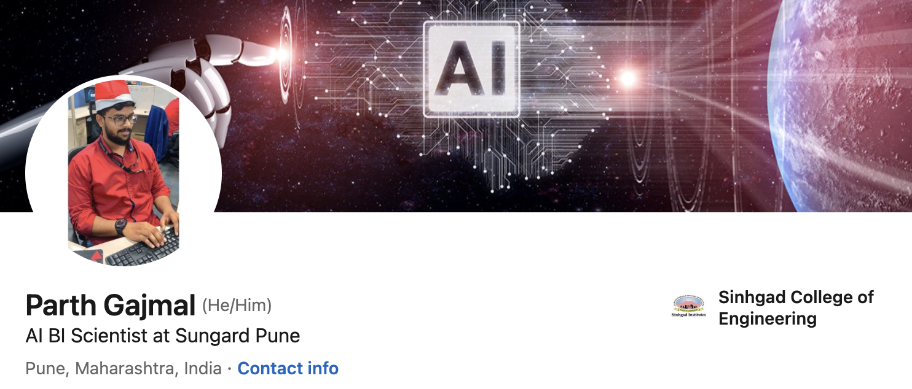

<!-- 

  

 -->

<h1 align="center">Hi 👋, I'm Parth Gajmal</h1>
<h3 align="center">Generative AI Engineer | Forward Deployed Engineer (FDE)</h3>

  

- 🔭 I’m focused on building **Production-Ready Generative AI applications, Agentic RAG systems, intelligent chatbots, and AI-driven automation solutions.**

- 🌱 I’m exploring and building solutions around **Agentic AI, Forward Deployed Engineering (FDE), LLM orchestration, AI Governance, and advanced RAG architectures.**

- 👨‍💻 My expertise includes **Python, LangChain, LangGraph, Pydantic AI, RAG, LLM Gateways, AI Guardrails, LLM Evaluation, and Observability.**

- 🚀 Experienced in developing **Enterprise Insurance RAG Chatbots and E-commerce AI Shopping Assistants** using modern GenAI technologies.

- 📝 I regularly write articles on [Medium](https://medium.com/@prgajmal)

- 💬 Ask me about **Generative AI, Agentic AI, RAG, LangGraph, LangChain, LLM Evaluation, AI Guardrails, Prompt Engineering, and Forward Deployed Engineering.**

- 📫 How to reach me **1994parthg@gmail.com**

- 📄 Know about my experience [LinkedIn Profile](https://www.linkedin.com/in/parthgajmal/)

- ⚡ Fun fact **When I'm not building AI solutions, I enjoy exploring new technologies, fitness, traveling, and creating content.**

### Blogs posts
<!-- BLOG-POST-LIST:START -->
<!-- BLOG-POST-LIST:END -->

<h3 align="left">Connect with me:</h3>

<h3 align="left">Languages and Tools:</h3>

&nbsp;

